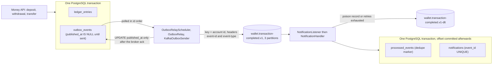
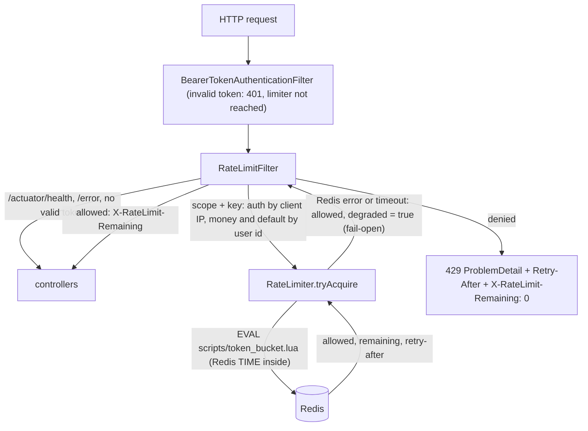

# Wallet Ledger API

> **Release status:** portfolio project. Synthetic data only. Not audited, not deployed, not for real funds.
> Uses production-style patterns; it is not production-deployed.
>
> **WP 5 status:** outbox, relay, consumer and dead-letter topic designed and implemented; M4 gate: GO (9 Nov 2026). 160 tests, 0 failures with `mvn verify`; 6 Spring contexts; CI run #37 green, 1m56s (code commit `42e1e65`); CI run #38 green, 2m11s (docs commit `bc6499c`, tagged `m4-gate`). No throughput figures were measured.
>
> **WP 6 status:** Redis rate limiter (Lua token bucket, fail-open) designed and implemented; steps 6.0 to 6.4 done, gate: GO (R1 to R5 on 15 Nov 2026, R6 closed by the design-decision answers; tag `wp6-gate`). 204 tests, 0 failures with `mvn verify`; 7 Spring contexts; CI run #43 green, 2m28s (run #42, a docs-only commit, failed on a test-isolation defect in an existing test; fixed in `8a901c7`). No throughput figures were measured.
>
> **WP 7 status:** observability implemented (request id and completion line, JSON logs in Compose, six `wallet.*` meters, authenticated `/actuator/metrics`); steps 7.0 to 7.3 done, gate decision pending the final CI run. 231 tests, 0 failures with `mvn verify`; 7 Spring contexts; CI run #49 green, 2m9s (code commit `3638f4b`). Docker proof on the real stack, not a benchmark; no throughput figures were measured.

Work in progress. The full README (architecture diagram, design decisions, benchmarks,
Limitations, Hardening before production) is written in WP 9.

## Requirements

| Tool | Version | Notes |
|---|---|---|
| Java | **21 exactly** | The Maven build fails fast on any other major version (maven-enforcer rule) |
| Maven | 3.9 | Same major version the Dockerfile uses |
| Docker | Docker Desktop, engine 28.x | Runs the stack and the Testcontainers tests |
| Kafka | `apache/kafka:4.2.2` (single-node KRaft) | Same tag in `docker-compose.yml` and the tests; matches the `kafka-clients` 4.2.2 managed by Boot 4.1.2. Multi-arch (arm64 and amd64) |
| Spring Boot | 4.1.x (built and tested on 4.1.2) | Managed by the parent POM |

Java 21 setup on macOS:

```bash
brew install --cask temurin@21
export JAVA_HOME=$(/usr/libexec/java_home -v 21)   # add this line to ~/.zshrc to make it permanent
java -version                                       # must report 21
```

On other platforms, install any JDK 21 distribution and point `JAVA_HOME` at it.

## Quickstart

```bash
# Start Postgres, Kafka, Redis and the app
docker compose up --build

# Health check (compose maps the app to host port 8081)
curl http://localhost:8081/actuator/health

# The events topic is declared by the app at start-up. Describe it from inside the broker
# (expect PartitionCount 3, ReplicationFactor 1).
docker compose exec kafka /opt/kafka/bin/kafka-topics.sh --bootstrap-server kafka:29092 --describe --topic wallet.transaction-completed.v1

# Watch the published events (key = account id, headers event-id and event-type). Ctrl+C to stop.
# Notifications written by the consumer (one row per event):
# docker compose exec postgres psql -U wallet -d wallet -c "select user_id, direction, amount, message from notifications order by id desc limit 10"

docker compose exec kafka /opt/kafka/bin/kafka-console-consumer.sh --bootstrap-server kafka:29092 \
  --topic wallet.transaction-completed.v1 --from-beginning --formatter-property print.key=true --formatter-property print.headers=true
```

The outbox relay publishes unpublished rows in id order about every 500 ms. Properties: `app.outbox.relay.enabled` (true in the app, false in tests), `batch-size` (100), `poll-interval` (500ms), `backoff-min` (1s), `backoff-max` (30s), `send-timeout-ms` (12000) and `app.outbox.topic`.

Try the API (the compose file supplies a throwaway dev `JWT_SECRET`):

```bash
curl -X POST http://localhost:8081/auth/register -H "Content-Type: application/json" \
  -d '{"email":"alice@example.com","password":"password123"}'

TOKEN=$(curl -s -X POST http://localhost:8081/auth/login -H "Content-Type: application/json" \
  -d '{"email":"alice@example.com","password":"password123"}' | sed -E 's/.*"accessToken":"([^"]+)".*/\1/')

curl -X POST http://localhost:8081/accounts -H "Authorization: Bearer $TOKEN" \
  -H "Content-Type: application/json" -d '{"currency":"SGD"}'
curl http://localhost:8081/accounts -H "Authorization: Bearer $TOKEN"
```

Move money. Every POST needs an `Idempotency-Key` header (1 to 64 printable ASCII characters, no spaces).
Amounts are in minor units (2500 = 25.00). Replace the account ids with your own; a transfer needs
two accounts in the same currency.

```bash
curl -X POST http://localhost:8081/accounts/1/deposits -H "Authorization: Bearer $TOKEN" \
  -H "Idempotency-Key: demo-1" -H "Content-Type: application/json" -d '{"amount":2500}'

curl -X POST http://localhost:8081/accounts/1/withdrawals -H "Authorization: Bearer $TOKEN" \
  -H "Idempotency-Key: demo-2" -H "Content-Type: application/json" -d '{"amount":500}'

curl -X POST http://localhost:8081/transfers -H "Authorization: Bearer $TOKEN" \
  -H "Idempotency-Key: demo-3" -H "Content-Type: application/json" \
  -d '{"fromAccountId":1,"toAccountId":2,"amount":1000}'

# History is newest first. Pass the returned cursor to get the next page.
curl "http://localhost:8081/accounts/1/transactions?limit=20" -H "Authorization: Bearer $TOKEN"
```

Sending the same request again with the same `Idempotency-Key` returns the stored response and moves no money.
The same key with a different body returns 422.

Run the tests (needs a running Docker daemon, because Testcontainers starts a real Postgres):

```bash
mvn verify
```

Run only the concurrency tests (tagged `concurrency`, see the next section):

```bash
mvn test -Dgroups=concurrency
```

## Concurrency proof (WP 4)

Production-style patterns, proven under real parallel load against a real PostgreSQL 16 (Testcontainers). The tests call the services directly (no HTTP), with up to 50 threads started together on a latch.

### What is tested

| Scenario | Result |
|---|---|
| Random transfers: 8 accounts x 10,000, 16 threads x 25 transfers | 400 of 400 succeed, total balance stays 80,000, ledger rows = 8 + 2 x 400, no negative balance |
| Hot account: 50 withdrawals of 100 on a balance of 1,000 | exactly 10 succeed, 40 refused (insufficient funds), final balance 0 |
| Hot account: 25 deposits and 25 withdrawals on one account, shuffled | every deposit succeeds, balance equals the exact sum of successful operations, never negative |
| One source to 20 destinations | all 20 succeed, money conserved |
| Same idempotency key, same body, 20 threads | 20 identical 201 responses, 1 transaction, 2 ledger entries, debited once |
| Same key, 20 different amounts | exactly 1 succeeds, 19 rejected as key reuse, only the winner's amount debited |
| Same key, first attempt fails (insufficient funds) | all 20 refused, no key stored, nothing changed |
| Real deadlock (forced, opposite lock order) | Postgres kills one transaction (40P01), the retry wrapper re-runs it once, both transfers applied exactly once |

Every test also asserts conservation (total balance) and exact row counts. The reconciliation check (SUM(CREDIT) - SUM(DEBIT) = balance) runs after every integration test, but it cannot catch a double-applied transfer, so it is never the only check.

### How it is checked

- Outcomes are classified by exception type (`OK`, `INSUFFICIENT`, `KEY_REUSE`, `BUSY`, `UNEXPECTED`). Any `UNEXPECTED` outcome fails the test.
- No sleeps are used for synchronization. A hang fails after 60 s instead of freezing the build.
- Random plans use a seeded `Random` and the seed is logged, so a failing run can be replayed.
- The concurrency tests share one Spring context (lock timeout 30 s, connection pool 50) and a Postgres container with `max_connections=200`.

### Results

Needs JDK 21 and Docker. Measured locally (Apple M2 Pro, JDK 21.0.12.1): on the Spring Boot 3.4.1 tree the 13 concurrency tests took 9.4 to 11.3 s per run, 10 of 10 runs green. On 4.1.2 the tag has 18 tests (13 + 5 outbox): 3 of 3 runs green after step 5.1 (Maven total 12.9 to 36.4 s) and 3 of 3 after step 5.2 (14.5 to 42.3 s). Times vary between runs for reasons not isolated, so they are not benchmarks. CI (GitHub Actions, ubuntu-24.04): the full suite (121 tests) is green in about 1m15s (run #30, 1m16s in total).

### Limitations

- Deposits and withdrawals have no deadlock retry. A deadlock there is unreachable by design (claim first, one row lock). Add a retry if a second lock is ever added.
- A busy account returns 409 after the lock timeout (2 s by default). Clients must retry.
- Tests run in one JVM against one database. They do not cover multiple app instances or HTTP-level load (that is WP 8).
- The tests prove exact outcomes. They do not measure how long threads waited on row locks.

## Benchmark environment

Benchmark numbers are published in WP 8. They are only meaningful with the environment beside them,
so the fields below are filled in at benchmark time, not guessed.

| Item | Value |
|---|---|
| Hardware | Apple M2 Pro, 12 cores (8 performance, 4 efficiency), 32 GB RAM |
| OS | macOS 15.3.2 |
| JDK (vendor and exact version) | _fill from `java -version` at benchmark time_ |
| Docker engine | 28.4.0 (Docker Desktop) |
| Docker Desktop VM memory | 16 GB (raised on 4 Nov 2026 from the 7.8 GB default) |

Docker on macOS runs inside a Linux VM, so these numbers are not equivalent to bare-metal Linux.
They are a reproducible baseline for this project, not production capacity figures.

## Status

| Work package | State |
|---|---|
| WP 1 Foundation | Done. Build, tests and CI green |
| WP 2 Auth and accounts | Done. Register, login (JWT), account endpoints with ownership checks, 17 tests, CI green |
| WP 3 Money movement | Done (M2). Idempotent deposit, withdrawal and transfer, cursor-paginated history, and a ledger reconciliation check after every integration test. 92 tests, 0 failures with `mvn verify`. CI run: #18 green, 57s |
| WP 4 Concurrency proof | Done (M3 gate: GO). Random transfers, hot account, idempotency-key races and a retry on a real deadlock, 13 tests tagged `concurrency`, no production code changed. 105 tests, 0 failures with `mvn verify`. CI run: #21 green, 1m17s |
| WP 5 step 5.0 Boot 4.1.2 migration | Done. Same behaviour and the same 105 tests, 0 failures with mvn verify. CI run: #23 green, 1m6s |
| WP 5 step 5.1 Outbox write path | Done. One outbox event per ledger entry, written inside the money transaction (an outbox failure rolls the money movement back). 119 tests, 0 failures with `mvn verify`; the `concurrency` tag now has 18 tests. CI run: #27 green, 1m14s |
| WP 5 step 5.2 Kafka infrastructure | Done. Single-node KRaft broker (`apache/kafka:4.2.2`) in Compose, the app declares topic `wallet.transaction-completed.v1` (3 partitions, replication factor 1), shared Testcontainers broker for the tests. Kafka is not part of the health groups; with the broker stopped, health stays UP and deposits still succeed. 121 tests, 0 failures with `mvn verify`. CI run: #30 green, 1m16s |
| WP 5 step 5.3 Outbox relay | Done. A background relay publishes outbox rows to Kafka in id order and marks a row only after the broker acknowledges it (at-least-once). Survives a broker outage and a deleted topic without restarting the app. 133 tests, 0 failures with `mvn verify`; the `concurrency` tag has 19 tests, 3 of 3 green. CI run: #32 green, 1m39s |
| WP 5 step 5.4 Idempotent consumer | Done. A Kafka consumer writes one notification per event (Flyway V2 `notifications`), deduplicating on `processed_events` in the same database transaction, with the offset committed after the DB commit. Poison and exhausted-retry records go to a dead-letter topic (`wallet.transaction-completed.v1-dlt`). A broker outage at start-up does not stop the app. 155 tests, 0 failures with `mvn verify`; the `concurrency` tag has 20 tests, 3 of 3 green. CI run: #33 green, 1m49s |
| WP 5 step 5.5 Failure proof | Done. Tests for the consumer lifecycle (stubbed registry) and for the whole chain against a hung broker (money endpoints unaffected, everything drains after the unpause with no restart). The `concurrency` tag passed 10 of 10 runs with zero ordering violations and `mvn verify` 3 of 3. A Docker chaos run (SIGKILL and SIGTERM mid-drain, broker paused, broker stopped, topic deleted, forced duplicates) ended with ledger entries = outbox events = notifications and no duplicate notification. 159 tests, 0 failures with `mvn verify`. CI run: #35 green, 2m2s |
| WP 5 step 5.6 M4 gate | GO on G1 to G5. `NotificationConsumerLifecycle.stop()` no longer throws when the registry fails (test L4, failing first on the old code). Fresh-clone `mvn verify` green and Compose smoke green. 160 tests, 0 failures. CI run: #37 green, 1m56s |
| WP 6 step 6.1 Token bucket | Dead code branch removed from the idempotency claim (the lock-timeout 409 path stays). Redis starter added with the Redis health indicator and repository scanning off. Lua token bucket and fail-open `RateLimiter`; atomicity proven against a real Redis (the allowed count equals min(capacity, callers) in every tested combination (1/32, 10/50, 100/64, 100/200), 5 of 5 runs each: exactly the capacity when callers outnumber tokens, and all callers when they do not). 172 tests, 6 contexts. CI run: #39 green, 2m16s |
| WP 6 step 6.2 Wiring | Validated `app.ratelimit.*` properties, flag-gated limiter, filter after bearer authentication, 429 `ProblemDetail` with `Retry-After`, Redis in Compose, a seventh Spring context with its own Redis. 190 tests. CI run: #40 green, 2m18s |
| WP 6 step 6.3 Failure behaviour | One WARN per outage window and one INFO on recovery, explicit reconnect back-off, 429 content type aligned with the advice. Paused, stopped and restarted Redis: money endpoints keep returning 201, health stays UP, limiting resumes without restarting the app. 204 tests, 7 contexts. CI run: #41 green, 2m22s |
| WP 6 step 6.4 Docker proof | No repository change. Burst, Redis paused and stopped under load, app start-up with Redis absent and a Redis restart on the Compose stack; ledger reconciled and ledger = outbox = notifications after every scenario. Not a benchmark |
| WP 6 CI incident (test isolation) | CI run #42 failed in `NotificationFullChainTest` (an extra notification, ledger entry 5, for account 6). Cause: `NotificationListenerTest` hard-coded account id 6 and ledger entry id 5 and wrote that row into the shared test database, so it appeared in another test's results whenever that test's wallet received account id 6, which depends on test class execution order. Not an application defect. Fixed in `8a901c7` (random ids from a range sequences never reach; no assertion changed); reproduced locally with `-Dsurefire.runOrder=reversealphabetical` before the fix and passing after. CI run #43 green, 2m28s. Why #41 passed: surefire's default filesystem class order differed per commit. In #42 and its re-run NotificationListenerTest ran at position 2, before NotificationFullChainTest at position 5. In #41 and #43 it ran after (27 vs 25, 43 vs 41). The order is stable per commit, so the re-run failed identically. Why the order changes between commits is inferred, not verified. |
| WP 7 Observability | Request id and one completion line per request, JSON logs in Compose, six `wallet.*` meters (outbox gauges, relay, consumer and limiter counters) and an authenticated `/actuator/metrics`. A leak found by a test (Hibernate logged a duplicate email) was fixed by switching that logger off. 231 tests, 7 contexts. CI run: #49 green, 2m9s |

## Outbox, relay and consumer (WP 5)

Production-style pattern: every ledger entry writes one row to `outbox_events` in the same database transaction as the money movement. A deposit or withdrawal writes 1 event, a transfer writes 2 (debit for the source account, credit for the destination). A background relay publishes these rows to Kafka in id order, and a consumer turns each event into exactly one notification (see the status table above and the limitations below).

### Architecture of the outbox chain



Limitations:

| Limitation | Impact | Why accepted | Fix before production |
|---|---|---|---|
| One relay instance | Several relays would double-publish and could reorder an account's events | Single-node portfolio project | Leader election or partitioned claims (for example `FOR UPDATE SKIP LOCKED` per partition) |
| One consumer thread, one consumer group | Throughput is bounded by one thread; no REST endpoint to read notifications | Correctness was the goal, not scale | More partitions and consumers; a read endpoint |
| Head-of-line blocking | A row that can never be published blocks every row behind it | Keeps per-account order; no quarantine built | Quarantine or dead-letter for unpublishable rows, with alerting |
| Kafka: one broker, replication factor 1, no data volume in Compose | A broker loss loses data | Disposable local broker | 3 brokers, replication factor 3, `min.insync.replicas` 2 |
| At-least-once with dedupe, not exactly-once | Duplicates reach the topic (seen in S3 and forced in S7); the consumer absorbs them | Idempotent consumer gives the same visible effect | Keep the dedupe; version the events |
| A notification for a user that does not exist (foreign-key failure) is retried 4 times, then dead-lettered | Delay, then a dead-letter record | Rare in this model | Classify the failure as non-retryable |
| Dead-letter records carry a full stack trace in a header; no replay tool | Large records; dead-lettered events need manual handling | Spring default; no replay need yet | Trim headers; replay tooling |
| Deleting a topic by hand loses records already marked published | Those events are not on the topic any more (S6: notifications existed only because they were consumed before) | Manual operator action | Retention policy, backups, a replay path from the outbox |
| The dead-letter topic is not re-declared if deleted while the app runs, or if the app started while the broker was down (FT3 showed it missing) | A poison record arriving then has no dead-letter topic | Narrow window | Re-declare it in the relay's `prepareRetry` or on a retry |
| `NotificationConsumerLifecycle.stop()` during a start in progress could leave the container running | At application shutdown the JVM is exiting anyway, so no lasting effect is expected | The one attempted fix had no test that failed on the old code, so it was not shipped | Bounded join on the starter thread, plus a test against the real container's behaviour |
| A `kill -9` duplicate was not observed | Dedupe under SIGKILL is not demonstrated (one kill landed outside the send-then-mark window); only SIGTERM (S3) and forced (S7) duplicates were observed | One kill is a small sample | Repeat kills at scale |
| The FT3 outage was short (about 1 s with rows waiting; S4 and S5 about 10 to 20 s) | Back-off growth was seen for one doubling only | Time box | A long-outage soak test |
| The relay polls the table | Up to one poll interval of delay, and constant query load | Simple and testable | Change-data-capture (Debezium) or LISTEN/NOTIFY |
| `outbox_events`, `processed_events` and `notifications` are never purged | Tables grow without bound | Synthetic data | Retention job or partitioning |
| Broker down at start-up: `KafkaAdmin` logs an ERROR and start-up takes about 10 s instead of about 3 s | Noisy log, slower start | Admin timeouts already cut from a measured 43 s | Health-aware start-up |
| The deadlock-plus-retry outbox test forces its own deadlock | It does not exercise the retry path of the real money services (unreachable by design) | Retry is tested separately in WP 4 | None needed |
| Local Docker start-up variance (observation): slow Ryuk start (6 to 19.5 s against about 2 s) coincided with the slow tag runs | Local timing varies between runs | Outside the app; cause not known | None for the app; investigate Docker Desktop |
| Chaos run is a correctness check, not a benchmark | No throughput figure exists | By design | A proper load test |

Hardening before production (short list): replication factor 3 with `min.insync.replicas` 2; relay leader election or partitioned claims; dead-letter replay tooling; metrics and alerting on outbox lag; retention and cleanup of published outbox rows and `processed_events`; schema registry and event versioning.

### Design decisions

#### 1. Why an outbox table instead of publishing to Kafka inside the money transaction?

Postgres and Kafka cannot commit together, so publishing and saving are two separate writes (a "dual write"), and either order can fail. If the app publishes first and the database then rolls back, the notification service announces a transfer that never happened: both people are told money moved while their balances did not change. If the database commits first and the publish then fails, the balances change but nobody is told, and nothing records that an event was owed, so the account holder may never notice the debit. The outbox row is written in the same database transaction as the money, so both exist or neither does. A separate relay then publishes the rows that exist, and retries until the broker acknowledges.

#### 2. Why one event per ledger entry, keyed by account id?

A transfer changes two accounts, so it writes two ledger entries (a debit and a credit), and each entry gets its own event. There is one topic, `wallet.transaction-completed.v1`, with 3 partitions. The Kafka key decides the partition and Kafka only guarantees order inside one partition, so keying by account id keeps each account's events in the order they happened. Events for different accounts can land on different partitions, so there is no ordering guarantee between accounts, and none is needed.

#### 3. What happens if the app crashes after Kafka acknowledges but before the row is marked published?

The row is still unpublished, so the relay sends it again and the topic ends up holding the same event twice. Kafka's idempotent producer setting does not prevent this: it only removes duplicates caused by retries inside one running producer, and a restarted app gets a new producer identity, so the broker stores the record again. This is acceptable only because the consumer ignores events it has already handled: it records each event id (the outbox row id) in `processed_events`, together with its consumer group. In the chaos run a graceful stop interrupted the relay mid-send and event 4142 appeared twice on the topic, and still produced exactly one notification. A `kill -9` did not produce a duplicate in the one run I made, so that case is reasoned, not observed.

#### 4. Why one transaction for the marker and the notification, and the offset committed afterwards?

If the marker and the notification were written separately, a crash between them could leave an event marked as done with no notification, or a notification with no marker. One transaction makes it all or nothing. The event id is assigned once, when the outbox row is created inside the money transaction, and the relay always resends that same row, so every copy carries the same id. The marker is inserted with `ON CONFLICT DO NOTHING`, so a second insert of the same id inserts nothing and the event is skipped. The offset (Kafka's bookmark of how far the consumer has read) is committed only after the database commit. A crash before the commit means Kafka redelivers and nothing was lost. A crash after the commit but before the offset also means redelivery, but the marker already exists, so the second handling does nothing. I reasoned about that second crash point but did not test a kill between those two moments.

#### 5. Why a polling relay rather than Debezium, and what does polling cost?

The relay is a background thread inside the app. On a 500 ms interval it queries `outbox_events` for rows where `published_at` is empty, sends them to Kafka in order, waits for the broker's acknowledgement, and only then sets `published_at`. Debezium would instead read Postgres's change log and push changes out, with no polling, but it needs Kafka Connect and extra infrastructure, which I judged out of scope for a solo, zero-budget project, so I did not build it. Polling costs up to one interval of added delay, a small constant query load on the database even when nothing is happening, and in this design it is limited to one relay instance because rows are not claimed.

#### 6. Why does the relay stop at the first failed row, and when would that hurt?

If the relay skipped a failed row and sent later ones, an account's events could arrive out of order, for example a withdrawal before the deposit that funded it. Stopping at the first failure keeps the order. The cost is head-of-line blocking: one row that can never be sent holds back every row behind it, for all accounts. A permanently bad payload would cause that, and there is no quarantine for such rows yet, which is listed as a limitation.

#### 7. Why is the notification a stored row and not an email or a push message?

The point of this part of the project is reliable, deduplicated processing, and a table row can be proven with a SQL count: one notification per ledger entry. An email or push needs an external provider and credentials, cannot be rolled back with the transaction, and cannot be counted exactly in a test. A row is also free and uses only synthetic data.

What the failure testing proved: with a hung, stopped or deleted broker the money endpoints kept returning 201 and health stayed UP; after the broker returned, every outbox row was published and every event produced exactly one notification without restarting the app; forced and shutdown-induced duplicates on the topic produced no duplicate notification. What it did not prove: that a `kill -9` produces a duplicate (the one kill did not), replay of records lost with a deleted topic, a long outage, several consumers or relays, other crash points on the consumer side, or any throughput figure. The chaos run is a correctness check, not a benchmark.

## Rate limiting (WP 6)

Production-style pattern: a Redis-backed token bucket (one Lua script) in front of the API that **fails open** when Redis is unavailable. It is off by default (`app.ratelimit.enabled=false`) and switched on by the Compose setup (`APP_RATELIMIT_ENABLED=true`), so it is part of the Docker quickstart and absent from the existing test contexts.

### How it works

- **Script:** `scripts/token_bucket.lua`. State is a hash (`tokens`, `ts`) per key. Time comes from Redis `TIME` inside the script, so every app instance shares one clock. A new key starts full. Cost is always 1. It returns allowed, remaining tokens and retry-after in milliseconds. The key expires when the bucket would be full again (minimum 1 s).
- **Filter:** `RateLimitFilter` is added to the Spring Security chain after bearer-token authentication. It is deliberately not a bean (a `Filter` bean is also registered in the servlet container and would run twice, halving every limit; test H1 proves exactly one token per request).
- **Counting rule:** it counts requests, not business operations. It runs before validation, authorization and idempotency, so an invalid request and an idempotent replay each consume a token.
- **429:** `ProblemDetail` JSON with content type `application/problem+json` and the same field names as the advice's 4xx bodies (`title`, `status`, `detail`, `instance`), plus `Retry-After` (whole seconds, at least 1) and `X-RateLimit-Remaining: 0`. Allowed requests carry `X-RateLimit-Remaining`. Degraded (fail-open) responses carry no extra header.
- **Redis client (chosen, not measured):** command timeout 100 ms, connect timeout 500 ms, commands rejected at once while disconnected, reconnect back-off exponential from 100 ms capped at 2 s, **no retry** on the limiter call.
- **Logging:** one WARN per outage window (`app.ratelimit.log-window`, default 30 s) with the number of suppressed failures, one INFO on recovery, nothing on the healthy path.
- **Compose:** `redis:7.2.17-alpine` (7.2 is the last BSD-licensed line), persistence off, no volume, no published port, `redis-cli ping` health check. The app waits for it at start-up; `depends_on` orders start-up only. Redis is not part of `/actuator/health` (`management.health.redis.enabled=false`).

### Request path through the limiter



### Scopes and defaults

| Scope | Key | Paths | Default (not tuned) |
|---|---|---|---|
| `auth` | `rl:auth:{client IP}` | `/auth/**` | burst 10, 10 per minute |
| `money` | `rl:money:{user id}` | `POST /accounts/{id}/deposits`, `POST /accounts/{id}/withdrawals`, `POST /transfers` | burst 20, 5 per second |
| `default` | `rl:default:{user id}` | every other authenticated endpoint | burst 60, 20 per second |
| none | none | `/actuator/health/**`, `/error`, requests without a valid token (the chain answers 401) | not limited |

Properties: `app.ratelimit.enabled`, `.auth|money|default.capacity`, `.auth|money|default.refill-per-second`, `.log-window`. A capacity or rate of 0 or below stops start-up. These defaults are starting values, not claims about correct limits.

### Evidence

Tests: 204 with `mvn verify`, 0 failures, 7 Spring contexts (the limiter-on context has its own Redis container that the tests pause, stop and restart). CI #43 green, 2m28s.

- **Atomicity (no Spring):** parallel callers against one bucket with negligible refill: capacity 1 with 32 callers, 10 with 50, and 100 with 200 each allowed exactly the capacity in 5 of 5 runs; three keys at once gave exactly 10 each. With 64 callers against capacity 100 all 64 were allowed.
- **HTTP:** exactly 5 deposits then 429 for capacity 5, and the denied request wrote no ledger, outbox or idempotency rows; users are isolated; reads use a separate bucket; login is limited per client IP; health is never limited; the 429 body has the same fields and content type as an advice body.
- **Failure behaviour (own Redis container):** with Redis paused, deposits beyond the capacity all returned 201, health stayed UP, one WARN was logged, and a request cost about the 100 ms command timeout (medians 116 and 130 ms), so the latency is bounded by the timeout, not fast. With Redis stopped the median was 6 ms (this setup only). After unpause or restart limiting resumed with no application restart.
- **Docker run (Compose stack, Docker Desktop, one local run each, scripts not committed, not a benchmark):** 10 logins per minute then 429 with `Retry-After`; 100 parallel deposits from one user gave 20 allowed and 80 denied; Redis paused for about 15 s and stopped for about 15 s under continuous load gave 0 5xx and 0 client failures in the load output, health UP in every sample, one WARN and one INFO per outage; the app started and served deposits with Redis absent and limiting resumed when Redis came back without restarting the app; a Redis restart reset a user's bucket; the recovery line appeared about 2.3 s after the Redis container started (three runs). After every scenario the ledger reconciled and ledger entries = outbox events = notifications, with the dead-letter topic empty.
- **Not proven:** several app instances, a long outage, real proxies, sustained load, any throughput.

### Limitations

| Limitation | Impact | Why accepted | Fix before production |
|---|---|---|---|
| Fail-open | During a Redis outage nothing is throttled, including login (credential stuffing exposure) | The user chose availability of money endpoints over protection (same principle as the Kafka outage) | Fail-closed for `auth` only, or a local fallback limiter |
| `X-Forwarded-For` is not trusted | Behind a proxy every client shares one IP. On Docker Desktop all local clients appear as one address and share one `auth` bucket, which throttles a naive load test | No proxy in this project | Trusted-proxy configuration |
| Invalid or expired tokens get 401 before the limiter runs | A flood of bad tokens is not limited | The limiter needs an authenticated user id | Limit by IP before authentication |
| Counts requests, not operations | Replays and invalid requests consume tokens | Protects the database from abuse | Count only completed operations |
| A Redis restart resets all buckets | Every user briefly has a full bucket (observed) | Limiter state is disposable, no persistence | Persistence or replication if it matters |
| Single Redis node, no persistence | Redis loss disables limiting (fail-open) | Portfolio project | Redis with replication |
| Compose `depends_on` orders start-up only | If Redis dies later the app keeps running | Fail-open is the intended behaviour | None needed |
| Timeouts and reconnect back-off are chosen, not measured | Values may not suit other environments | Time box | Measure under real conditions |
| A paused Redis costs about the command timeout per request | Added latency during that kind of outage | Bounded by design | Circuit breaker that skips Redis after repeated failures |
| Defaults are not tuned | The numbers are starting points | No load data yet | Tune after the WP 8 load tests |
| Redis idempotency fast path not built (chosen, not a defect) | Replays always go to Postgres | Postgres inside the money transaction is the single source of truth for idempotency; a Redis fast path would add a second source of truth and a new failure mode on the money path, for a latency benefit nothing here needs | Only if replay latency is measured to matter, with Redis as a hint and Postgres as the authority |
| Tests: single local runs | Recovery times and latencies are not benchmarks | By design | A proper load test |
| Hibernate JDBC error logging is disabled (logger `org.hibernate.orm.jdbc.error` set to OFF) | The diagnostic lines for unexpected database errors from that logger are lost. Residual: the `PSQLException` message in a stack trace on an unexpected 500 can still carry the same `Detail:` text (for example a key value such as an email), so the logs are not claimed clean; the leak checks cover only the tested paths | Postgres error detail can contain key values such as emails, and Hibernate logged it at WARN on an ordinary duplicate registration. Our own `ApiExceptionHandler` still logs the exception and stack trace on unexpected 500s, so diagnosis is not lost | A log filter that keeps the SQLSTATE and constraint name and drops the `Detail:` text |

### Hardening before production (rate limiter)

Trusted-proxy handling for the client IP; Redis replication or a managed Redis; per-endpoint limits tuned from measurement; metrics and alerts on degraded decisions; fail-closed or a local fallback limiter for the login scope.

### Design decisions (limiter)

#### 8. Why a token bucket rather than a fixed window?

A token bucket allows a short burst up to its capacity while enforcing an average rate through its refill. A fixed window can let a client send two full windows' worth of requests around the boundary between two windows. A sliding window avoids that but keeps more state per client. The price of the token bucket is two numbers to tune (capacity and refill rate), and the defaults here are starting values, not measured optima.

#### 9. Why a Lua script in Redis rather than reading and writing the count from Java?

Reading the token count, deciding, and writing it back from Java is three steps, and two concurrent requests can both read the same count and both be allowed. Redis runs a Lua script as one uninterrupted unit, so the check and the update happen atomically in a single round trip. The test sends 32 to 200 parallel calls at a bucket of capacity C. The number allowed equals the smaller of C and the number of callers: exactly C when there are more callers than tokens, and all of them when there are fewer. No call is ever wrongly allowed or denied. The cost is that the logic lives in a second language that is harder to debug.

#### 10. Why Redis's own clock (`TIME`) inside the script rather than the application's clock?

Redis is the one clock shared by every application instance, so refills stay consistent even if app servers' clocks differ. The cost is that tests cannot fake the time, so the burst tests use a bucket that effectively never refills, and the refill test uses a bounded wait instead of a sleep.

#### 11. Why fail open when Redis is down, and what does it cost?

If Redis errors or times out, the limiter allows the request (with a 100 ms command timeout and no retry), so the money endpoints keep working. I tested a paused and a stopped Redis: deposits kept returning 201 and health stayed UP. After the Redis was unpaused or restarted, limiting resumed without restarting the app. The cost is that nothing is throttled during an outage, including login attempts. Failing closed would protect the database and the login endpoint, but a Redis outage would then take the whole wallet down. I chose availability for a wallet and wrote the cost down as a limitation.

#### 12. Why key money endpoints by user id but login by IP address?

A money request has a signed-in user, so the limit follows the account holder whichever address they come from. Login has no user yet, so the only available identity is the client IP. Limiting everything by IP would be unfair to users behind a shared address. The IP rule has a known weakness: the app does not trust `X-Forwarded-For`, and under Docker Desktop every local client appears as one IP and shares one login bucket.

#### 13. Why a request id and one completion line per request?

When something goes wrong, the first question is "what happened to this request?". Every response carries an `X-Request-Id`, and every request except health probes writes exactly one completion line with the method, path, status, duration, request id and, when the caller is signed in, the user id. That makes a request traceable even when it was rejected with a 401 or a 429. A client may send its own id, but it is accepted only if it matches a strict whitelist; otherwise the server generates one, so a client cannot inject extra lines into the log. In a run of 411 requests there were 411 distinct completion ids, none missing and none duplicated.

#### 14. Why only `outcome` and `scope` as metric tags, and never a user id?

Every distinct tag value creates a separate time series, so a user or account id as a tag would create an unbounded number of series and make the metrics heavier as the user base grows. The meters answer questions about the system (is the outbox draining, are duplicates or bad events occurring, is the limiter degraded). Per-user detail belongs in the logs, which already carry the user id. A test lists every `wallet.*` meter and fails if any tag key other than `outcome` or `scope` appears.

#### 15. Why measure outbox lag with a count and an oldest-age gauge?

"Is the outbox draining?" decides whether events are being delivered at all. The unpublished count shows the size of the backlog, and the oldest-age gauge shows how long the worst event has been waiting. In the run where the broker was paused for 25 seconds, deposits kept returning 201 while the unpublished count rose from 12 to 47 and the oldest age from 6 to 24 seconds. After the broker returned, both went back to 0. The count query grows with the backlog during a long outage, which is acceptable behind a 5-second cache for this project.

#### 16. Why are the gauges cached for 5 seconds, and why do they report NaN on a database error?

The gauges read the database, so computing them on every metrics request could add load to Postgres exactly when it is struggling. A 5-second cache bounds that cost. If the read fails, the gauge reports NaN instead of throwing or logging on every call, so a metrics problem can never break the application or flood the log. The price is that the gauges can lag by about the cache interval; about 6 seconds of lag was seen in the outage run.

#### 17. Why is the metrics endpoint authenticated, but on the main port?

Operational numbers should not be public, so `/actuator/metrics` requires a token and only health is open. A separate management port would be cleaner, but it would move the health URL that the quickstart and the Compose healthchecks use, which was too invasive for this package. The cost is that any signed-in user can read the metrics, and reading them uses up that user's rate-limit allowance. This is listed as a limitation.

#### 18. Why is Hibernate's JDBC error logging switched off?

A test written to check that the logs contain no sensitive data found a real leak: registering an email that already exists made Hibernate log Postgres's detail line, which contains the email address. The application already returns a clean 409, so I switched that one logger off. The cost is losing Hibernate's own SQL-error log lines. Unexpected 500 errors are still logged with a stack trace by our own error handler, and that stack trace can still contain database error text, so the residual risk is a documented limitation rather than something I claim to have removed.

## Observability (WP 7)

What an operator can answer from the logs and metrics without a debugger. Descriptive; the reasoning is in decisions 13 to 18.

### What is logged

- **Request id:** every response carries `X-Request-Id`, including 401 and 429 responses. A client-supplied id is used only if it matches `[A-Za-z0-9._-]{1,64}`; otherwise a UUID is generated and the supplied value is never logged or echoed.
- **Completion line:** every request except `/actuator/health/**` writes one INFO line: `request completed method=... path=... status=... durationMs=... requestId=...` and `userId=...` when the caller is authenticated. The path is the matched pattern when a handler matched, otherwise the raw path without the query string (so the 429 line from the limiter shows the raw path, including an account id). No bodies, headers, query strings, tokens or `Idempotency-Key` values are logged.
- **Format:** JSON in Compose (`LOGGING_STRUCTURED_FORMAT_CONSOLE=logstash`, with `requestId` and `userId` as top-level fields); plain text locally and in tests, where the request id appears only on the completion line.

### Meters (`GET /actuator/metrics`, authenticated)

| Meter | Type | Tags | Question it answers |
|---|---|---|---|
| `wallet.outbox.unpublished` | gauge | none | Is the outbox draining? (backlog size) |
| `wallet.outbox.oldest.age.seconds` | gauge | none | Is the outbox draining? (how long the oldest event has waited) |
| `wallet.relay.published` | counter | none | How many outbox rows were marked published? |
| `wallet.relay.failed` | counter | none | How often did the relay fail? |
| `wallet.consumer.events` | counter | `outcome`: processed, duplicate, dead_lettered, skipped | Are duplicates or bad events occurring? |
| `wallet.ratelimit.decisions` | counter | `scope`: auth, money, default; `outcome`: allowed, denied, degraded | Is the limiter healthy? |

Money outcomes (201, 409, 422, 429) come from Spring's `http.server.requests`. Reading a meter:

```bash
TOKEN=$(curl -s -X POST http://localhost:8081/auth/login -H "Content-Type: application/json" \
  -d '{"email":"alice@example.com","password":"password123"}' | python3 -c 'import sys,json;print(json.load(sys.stdin)["accessToken"])')
curl -s -H "Authorization: Bearer $TOKEN" http://localhost:8081/actuator/metrics/wallet.outbox.unpublished
curl -s -H "Authorization: Bearer $TOKEN" "http://localhost:8081/actuator/metrics/wallet.ratelimit.decisions?tag=scope:money&tag=outcome:denied"
```

Evidence (single local runs, not benchmarks): the meters agreed with the database and with the client's own counts per scope in a 411-request run; during a 25-second Kafka pause the unpublished count rose from 12 to 47 and the oldest age from 6 to 24 seconds, then returned to 0; a 1-second Redis pause raised `degraded` by 10 with health UP.

### Limitations (WP 7)

| Limitation | Impact | Why accepted | Fix before production |
|---|---|---|---|
| Any authenticated user can read `/actuator/metrics` | Operational numbers are visible to every signed-in user | Moving management to another port would move the health URL used by the quickstart and the healthchecks | Separate management port or network |
| Metrics reads consume the reader's `default` rate-limit bucket | A scraper counts against its own allowance | Same cause as above | Separate management port or network |
| The unpublished-count query grows with the backlog | During a long outage the query gets slower | Behind a 5-second cache; acceptable here | A cheaper estimate, or alert on the oldest age |
| Gauges lag by about 5 seconds | A change shows up late (about 6 seconds seen) | The cache protects Postgres | None needed |
| Plain-text local logs carry the request id only on the completion line | Other local lines cannot be matched by id | JSON in Compose carries it on every line; changing the pattern is dev convenience only | Add the id to the plain-text pattern if wanted |
| A client-supplied request id is whitelisted but spoofable | A client can pick its own id, within the whitelist | The whitelist prevents log injection | Always generate the id at the edge |
| Unexpected-500 stack traces may carry database error text | Key values such as an email could appear in a log | Our handler logs the trace for diagnosis; no 500 occurred in the Docker run | A sanitising log filter |
| Hibernate JDBC error logging is off (logger `org.hibernate.orm.jdbc.error`) | Hibernate's own SQL-error lines are lost | It logged the email on a duplicate registration | See the log filter above |
| 429 responses appear under `uri=UNKNOWN` in `http.server.requests` | Money and auth 429s are separable only through `wallet.ratelimit.decisions` | The limiter rejects before a handler matches | Tag the 429 in the filter, if needed |
| Timings and values are single local runs | Not benchmarks | By design | WP 8 load test |
| No sustained-load run yet | Metric values under sustained load are unknown | Planned for WP 8 | k6 run |

### Hardening before production (observability)

A separate management port or network for metrics; a sanitising log filter that keeps the SQLSTATE and constraint name and drops the `Detail:` text; trusted-proxy handling for the client IP and for request ids.
