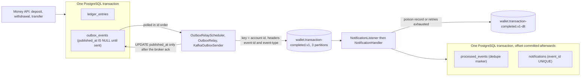
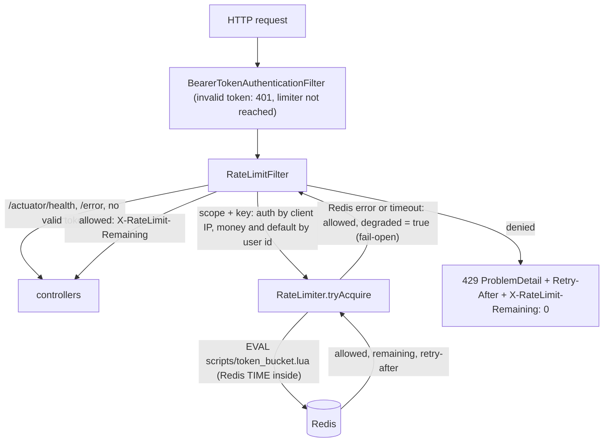

# Wallet Ledger API

> **Release status:** portfolio project. Synthetic data only. Not audited, not deployed, not for real funds.
> Uses production-style patterns; it is not production-deployed.
>
> **WP 5 status:** outbox, relay, consumer and dead-letter topic designed and implemented; M4 gate: GO (9 Nov 2026). 160 tests, 0 failures with `mvn verify`; 6 Spring contexts; CI run #37 green, 1m56s (code commit `42e1e65`); CI run #38 green, 2m11s (docs commit `bc6499c`, tagged `m4-gate`). No throughput figures were measured. **The WP 5 design-decision answers (see Design decisions below) are still pending.**
>
> **WP 6 status:** Redis rate limiter (Lua token bucket, fail-open) designed and implemented; steps 6.0 to 6.4 done, gate decision pending (the design-decision answers, Q1 to Q12, are still to be written). 204 tests, 0 failures with `mvn verify`; 7 Spring contexts; CI run #41 green, 2m22s. No throughput figures were measured.

Work in progress. The full README (architecture diagram, design decisions, benchmarks,
Limitations, Hardening before production) is written in WP 9.

## Requirements

| Tool | Version | Notes |
|---|---|---|
| Java | **21 exactly** | The Maven build fails fast on any other major version (maven-enforcer rule) |
| Maven | 3.9 | Same major version the Dockerfile uses |
| Docker | Docker Desktop, engine 28.x | Runs the stack and the Testcontainers tests |
| Kafka | `apache/kafka:4.2.2` (single-node KRaft) | Same tag in `docker-compose.yml` and the tests; matches the `kafka-clients` 4.2.2 managed by Boot 4.1.2. Multi-arch (arm64 and amd64) |
| Spring Boot | 4.1.x (built and tested on 4.1.2) | Managed by the parent POM |

Java 21 setup on macOS:

```bash
brew install --cask temurin@21
export JAVA_HOME=$(/usr/libexec/java_home -v 21)   # add this line to ~/.zshrc to make it permanent
java -version                                       # must report 21
```

On other platforms, install any JDK 21 distribution and point `JAVA_HOME` at it.

## Quickstart

```bash
# Start Postgres, Kafka, Redis and the app
docker compose up --build

# Health check (compose maps the app to host port 8081)
curl http://localhost:8081/actuator/health

# The events topic is declared by the app at start-up. Describe it from inside the broker
# (expect PartitionCount 3, ReplicationFactor 1).
docker compose exec kafka /opt/kafka/bin/kafka-topics.sh --bootstrap-server kafka:29092 --describe --topic wallet.transaction-completed.v1

# Watch the published events (key = account id, headers event-id and event-type). Ctrl+C to stop.
# Notifications written by the consumer (one row per event):
# docker compose exec postgres psql -U wallet -d wallet -c "select user_id, direction, amount, message from notifications order by id desc limit 10"

docker compose exec kafka /opt/kafka/bin/kafka-console-consumer.sh --bootstrap-server kafka:29092 \
  --topic wallet.transaction-completed.v1 --from-beginning --formatter-property print.key=true --formatter-property print.headers=true
```

The outbox relay publishes unpublished rows in id order about every 500 ms. Properties: `app.outbox.relay.enabled` (true in the app, false in tests), `batch-size` (100), `poll-interval` (500ms), `backoff-min` (1s), `backoff-max` (30s), `send-timeout-ms` (12000) and `app.outbox.topic`.

Try the API (the compose file supplies a throwaway dev `JWT_SECRET`):

```bash
curl -X POST http://localhost:8081/auth/register -H "Content-Type: application/json" \
  -d '{"email":"alice@example.com","password":"password123"}'

TOKEN=$(curl -s -X POST http://localhost:8081/auth/login -H "Content-Type: application/json" \
  -d '{"email":"alice@example.com","password":"password123"}' | sed -E 's/.*"accessToken":"([^"]+)".*/\1/')

curl -X POST http://localhost:8081/accounts -H "Authorization: Bearer $TOKEN" \
  -H "Content-Type: application/json" -d '{"currency":"SGD"}'
curl http://localhost:8081/accounts -H "Authorization: Bearer $TOKEN"
```

Move money. Every POST needs an `Idempotency-Key` header (1 to 64 printable ASCII characters, no spaces).
Amounts are in minor units (2500 = 25.00). Replace the account ids with your own; a transfer needs
two accounts in the same currency.

```bash
curl -X POST http://localhost:8081/accounts/1/deposits -H "Authorization: Bearer $TOKEN" \
  -H "Idempotency-Key: demo-1" -H "Content-Type: application/json" -d '{"amount":2500}'

curl -X POST http://localhost:8081/accounts/1/withdrawals -H "Authorization: Bearer $TOKEN" \
  -H "Idempotency-Key: demo-2" -H "Content-Type: application/json" -d '{"amount":500}'

curl -X POST http://localhost:8081/transfers -H "Authorization: Bearer $TOKEN" \
  -H "Idempotency-Key: demo-3" -H "Content-Type: application/json" \
  -d '{"fromAccountId":1,"toAccountId":2,"amount":1000}'

# History is newest first. Pass the returned cursor to get the next page.
curl "http://localhost:8081/accounts/1/transactions?limit=20" -H "Authorization: Bearer $TOKEN"
```

Sending the same request again with the same `Idempotency-Key` returns the stored response and moves no money.
The same key with a different body returns 422.

Run the tests (needs a running Docker daemon, because Testcontainers starts a real Postgres):

```bash
mvn verify
```

Run only the concurrency tests (tagged `concurrency`, see the next section):

```bash
mvn test -Dgroups=concurrency
```

## Concurrency proof (WP 4)

Production-style patterns, proven under real parallel load against a real PostgreSQL 16 (Testcontainers). The tests call the services directly (no HTTP), with up to 50 threads started together on a latch.

### What is tested

| Scenario | Result |
|---|---|
| Random transfers: 8 accounts x 10,000, 16 threads x 25 transfers | 400 of 400 succeed, total balance stays 80,000, ledger rows = 8 + 2 x 400, no negative balance |
| Hot account: 50 withdrawals of 100 on a balance of 1,000 | exactly 10 succeed, 40 refused (insufficient funds), final balance 0 |
| Hot account: 25 deposits and 25 withdrawals on one account, shuffled | every deposit succeeds, balance equals the exact sum of successful operations, never negative |
| One source to 20 destinations | all 20 succeed, money conserved |
| Same idempotency key, same body, 20 threads | 20 identical 201 responses, 1 transaction, 2 ledger entries, debited once |
| Same key, 20 different amounts | exactly 1 succeeds, 19 rejected as key reuse, only the winner's amount debited |
| Same key, first attempt fails (insufficient funds) | all 20 refused, no key stored, nothing changed |
| Real deadlock (forced, opposite lock order) | Postgres kills one transaction (40P01), the retry wrapper re-runs it once, both transfers applied exactly once |

Every test also asserts conservation (total balance) and exact row counts. The reconciliation check (SUM(CREDIT) - SUM(DEBIT) = balance) runs after every integration test, but it cannot catch a double-applied transfer, so it is never the only check.

### How it is checked

- Outcomes are classified by exception type (`OK`, `INSUFFICIENT`, `KEY_REUSE`, `BUSY`, `UNEXPECTED`). Any `UNEXPECTED` outcome fails the test.
- No sleeps are used for synchronization. A hang fails after 60 s instead of freezing the build.
- Random plans use a seeded `Random` and the seed is logged, so a failing run can be replayed.
- The concurrency tests share one Spring context (lock timeout 30 s, connection pool 50) and a Postgres container with `max_connections=200`.

### Results

Needs JDK 21 and Docker. Measured locally (Apple M2 Pro, JDK 21.0.12.1): on the Spring Boot 3.4.1 tree the 13 concurrency tests took 9.4 to 11.3 s per run, 10 of 10 runs green. On 4.1.2 the tag has 18 tests (13 + 5 outbox): 3 of 3 runs green after step 5.1 (Maven total 12.9 to 36.4 s) and 3 of 3 after step 5.2 (14.5 to 42.3 s). Times vary between runs for reasons not isolated, so they are not benchmarks. CI (GitHub Actions, ubuntu-24.04): the full suite (121 tests) is green in about 1m15s (run #30, 1m16s in total).

### Limitations

- Deposits and withdrawals have no deadlock retry. A deadlock there is unreachable by design (claim first, one row lock). Add a retry if a second lock is ever added.
- A busy account returns 409 after the lock timeout (2 s by default). Clients must retry.
- Tests run in one JVM against one database. They do not cover multiple app instances or HTTP-level load (that is WP 8).
- The tests prove exact outcomes. They do not measure how long threads waited on row locks.

## Benchmark environment

Benchmark numbers are published in WP 8. They are only meaningful with the environment beside them,
so the fields below are filled in at benchmark time, not guessed.

| Item | Value |
|---|---|
| Hardware | Apple M2 Pro, 12 cores (8 performance, 4 efficiency), 32 GB RAM |
| OS | macOS 15.3.2 |
| JDK (vendor and exact version) | _fill from `java -version` at benchmark time_ |
| Docker engine | 28.4.0 (Docker Desktop) |
| Docker Desktop VM memory | 16 GB (raised on 4 Nov 2026 from the 7.8 GB default) |

Docker on macOS runs inside a Linux VM, so these numbers are not equivalent to bare-metal Linux.
They are a reproducible baseline for this project, not production capacity figures.

## Status

| Work package | State |
|---|---|
| WP 1 Foundation | Done. Build, tests and CI green |
| WP 2 Auth and accounts | Done. Register, login (JWT), account endpoints with ownership checks, 17 tests, CI green |
| WP 3 Money movement | Done (M2). Idempotent deposit, withdrawal and transfer, cursor-paginated history, and a ledger reconciliation check after every integration test. 92 tests, 0 failures with `mvn verify`. CI run: #18 green, 57s |
| WP 4 Concurrency proof | Done (M3 gate: GO). Random transfers, hot account, idempotency-key races and a retry on a real deadlock, 13 tests tagged `concurrency`, no production code changed. 105 tests, 0 failures with `mvn verify`. CI run: #21 green, 1m17s |
| WP 5 step 5.0 Boot 4.1.2 migration | Done. Same behaviour and the same 105 tests, 0 failures with mvn verify. CI run: #23 green, 1m6s |
| WP 5 step 5.1 Outbox write path | Done. One outbox event per ledger entry, written inside the money transaction (an outbox failure rolls the money movement back). 119 tests, 0 failures with `mvn verify`; the `concurrency` tag now has 18 tests. CI run: #27 green, 1m14s |
| WP 5 step 5.2 Kafka infrastructure | Done. Single-node KRaft broker (`apache/kafka:4.2.2`) in Compose, the app declares topic `wallet.transaction-completed.v1` (3 partitions, replication factor 1), shared Testcontainers broker for the tests. Kafka is not part of the health groups; with the broker stopped, health stays UP and deposits still succeed. 121 tests, 0 failures with `mvn verify`. CI run: #30 green, 1m16s |
| WP 5 step 5.3 Outbox relay | Done. A background relay publishes outbox rows to Kafka in id order and marks a row only after the broker acknowledges it (at-least-once). Survives a broker outage and a deleted topic without restarting the app. 133 tests, 0 failures with `mvn verify`; the `concurrency` tag has 19 tests, 3 of 3 green. CI run: #32 green, 1m39s |
| WP 5 step 5.4 Idempotent consumer | Done. A Kafka consumer writes one notification per event (Flyway V2 `notifications`), deduplicating on `processed_events` in the same database transaction, with the offset committed after the DB commit. Poison and exhausted-retry records go to a dead-letter topic (`wallet.transaction-completed.v1-dlt`). A broker outage at start-up does not stop the app. 155 tests, 0 failures with `mvn verify`; the `concurrency` tag has 20 tests, 3 of 3 green. CI run: #33 green, 1m49s |
| WP 5 step 5.5 Failure proof | Done. Tests for the consumer lifecycle (stubbed registry) and for the whole chain against a hung broker (money endpoints unaffected, everything drains after the unpause with no restart). The `concurrency` tag passed 10 of 10 runs with zero ordering violations and `mvn verify` 3 of 3. A Docker chaos run (SIGKILL and SIGTERM mid-drain, broker paused, broker stopped, topic deleted, forced duplicates) ended with ledger entries = outbox events = notifications and no duplicate notification. 159 tests, 0 failures with `mvn verify`. CI run: #35 green, 2m2s |
| WP 5 step 5.6 M4 gate | GO on G1 to G5. `NotificationConsumerLifecycle.stop()` no longer throws when the registry fails (test L4, failing first on the old code). Fresh-clone `mvn verify` green and Compose smoke green. 160 tests, 0 failures. CI run: #37 green, 1m56s |
| WP 6 step 6.1 Token bucket | Dead code branch removed from the idempotency claim (the lock-timeout 409 path stays). Redis starter added with the Redis health indicator and repository scanning off. Lua token bucket and fail-open `RateLimiter`; atomicity proven against a real Redis (exactly the capacity allowed in 5 of 5 runs for each tested combination). 172 tests, 6 contexts. CI run: #39 green, 2m16s |
| WP 6 step 6.2 Wiring | Validated `app.ratelimit.*` properties, flag-gated limiter, filter after bearer authentication, 429 `ProblemDetail` with `Retry-After`, Redis in Compose, a seventh Spring context with its own Redis. 190 tests. CI run: #40 green, 2m18s |
| WP 6 step 6.3 Failure behaviour | One WARN per outage window and one INFO on recovery, explicit reconnect back-off, 429 content type aligned with the advice. Paused, stopped and restarted Redis: money endpoints keep returning 201, health stays UP, limiting resumes without restarting the app. 204 tests, 7 contexts. CI run: #41 green, 2m22s |
| WP 6 step 6.4 Docker proof | No repository change. Burst, Redis paused and stopped under load, app start-up with Redis absent and a Redis restart on the Compose stack; ledger reconciled and ledger = outbox = notifications after every scenario. Not a benchmark |

## Outbox, relay and consumer (WP 5)

Production-style pattern: every ledger entry writes one row to `outbox_events` in the same database transaction as the money movement. A deposit or withdrawal writes 1 event, a transfer writes 2 (debit for the source account, credit for the destination). A background relay publishes these rows to Kafka in id order, and a consumer turns each event into exactly one notification (see the status table above and the limitations below).

### Architecture of the outbox chain



Limitations:

| Limitation | Impact | Why accepted | Fix before production |
|---|---|---|---|
| One relay instance | Several relays would double-publish and could reorder an account's events | Single-node portfolio project | Leader election or partitioned claims (for example `FOR UPDATE SKIP LOCKED` per partition) |
| One consumer thread, one consumer group | Throughput is bounded by one thread; no REST endpoint to read notifications | Correctness was the goal, not scale | More partitions and consumers; a read endpoint |
| Head-of-line blocking | A row that can never be published blocks every row behind it | Keeps per-account order; no quarantine built | Quarantine or dead-letter for unpublishable rows, with alerting |
| Kafka: one broker, replication factor 1, no data volume in Compose | A broker loss loses data | Disposable local broker | 3 brokers, replication factor 3, `min.insync.replicas` 2 |
| At-least-once with dedupe, not exactly-once | Duplicates reach the topic (seen in S3 and forced in S7); the consumer absorbs them | Idempotent consumer gives the same visible effect | Keep the dedupe; version the events |
| A notification for a user that does not exist (foreign-key failure) is retried 4 times, then dead-lettered | Delay, then a dead-letter record | Rare in this model | Classify the failure as non-retryable |
| Dead-letter records carry a full stack trace in a header; no replay tool | Large records; dead-lettered events need manual handling | Spring default; no replay need yet | Trim headers; replay tooling |
| Deleting a topic by hand loses records already marked published | Those events are not on the topic any more (S6: notifications existed only because they were consumed before) | Manual operator action | Retention policy, backups, a replay path from the outbox |
| The dead-letter topic is not re-declared if deleted while the app runs, or if the app started while the broker was down (FT3 showed it missing) | A poison record arriving then has no dead-letter topic | Narrow window | Re-declare it in the relay's `prepareRetry` or on a retry |
| `NotificationConsumerLifecycle.stop()` during a start in progress could leave the container running | At application shutdown the JVM is exiting anyway, so no lasting effect is expected | The one attempted fix had no test that failed on the old code, so it was not shipped | Bounded join on the starter thread, plus a test against the real container's behaviour |
| A `kill -9` duplicate was not observed | Dedupe under SIGKILL is not demonstrated (one kill landed outside the send-then-mark window); only SIGTERM (S3) and forced (S7) duplicates were observed | One kill is a small sample | Repeat kills at scale |
| The FT3 outage was short (about 1 s with rows waiting; S4 and S5 about 10 to 20 s) | Back-off growth was seen for one doubling only | Time box | A long-outage soak test |
| The relay polls the table | Up to one poll interval of delay, and constant query load | Simple and testable | Change-data-capture (Debezium) or LISTEN/NOTIFY |
| `outbox_events`, `processed_events` and `notifications` are never purged | Tables grow without bound | Synthetic data | Retention job or partitioning |
| Broker down at start-up: `KafkaAdmin` logs an ERROR and start-up takes about 10 s instead of about 3 s | Noisy log, slower start | Admin timeouts already cut from a measured 43 s | Health-aware start-up |
| The deadlock-plus-retry outbox test forces its own deadlock | It does not exercise the retry path of the real money services (unreachable by design) | Retry is tested separately in WP 4 | None needed |
| Local Docker start-up variance (observation): slow Ryuk start (6 to 19.5 s against about 2 s) coincided with the slow tag runs | Local timing varies between runs | Outside the app; cause not known | None for the app; investigate Docker Desktop |
| Chaos run is a correctness check, not a benchmark | No throughput figure exists | By design | A proper load test |

Hardening before production (short list): replication factor 3 with `min.insync.replicas` 2; relay leader election or partitioned claims; dead-letter replay tooling; metrics and alerting on outbox lag; retention and cleanup of published outbox rows and `processed_events`; schema registry and event versioning.

### Design decisions

Pending: the author's own words (to be added). Questions: why an outbox table instead of publishing inside the money transaction; why one event per ledger entry, keyed by account id; what happens on a crash after the broker ack but before the mark, and why that is acceptable; why the consumer writes the marker and the notification in one transaction and commits the offset afterwards; why a polling relay rather than Debezium, and what polling costs; why the relay stops at the first failed row and when that hurts; why a notification is a stored row.

What the failure testing proved: with a hung, stopped or deleted broker the money endpoints kept returning 201 and health stayed UP; after the broker returned, every outbox row was published and every event produced exactly one notification without restarting the app; forced and shutdown-induced duplicates on the topic produced no duplicate notification. What it did not prove: that a `kill -9` produces a duplicate (the one kill did not), replay of records lost with a deleted topic, a long outage, several consumers or relays, other crash points on the consumer side, or any throughput figure. The chaos run is a correctness check, not a benchmark.

## Rate limiting (WP 6)

Production-style pattern: a Redis-backed token bucket (one Lua script) in front of the API that **fails open** when Redis is unavailable. It is off by default (`app.ratelimit.enabled=false`) and switched on by the Compose setup (`APP_RATELIMIT_ENABLED=true`), so it is part of the Docker quickstart and absent from the existing test contexts.

### How it works

- **Script:** `scripts/token_bucket.lua`. State is a hash (`tokens`, `ts`) per key. Time comes from Redis `TIME` inside the script, so every app instance shares one clock. A new key starts full. Cost is always 1. It returns allowed, remaining tokens and retry-after in milliseconds. The key expires when the bucket would be full again (minimum 1 s).
- **Filter:** `RateLimitFilter` is added to the Spring Security chain after bearer-token authentication. It is deliberately not a bean (a `Filter` bean is also registered in the servlet container and would run twice, halving every limit; test H1 proves exactly one token per request).
- **Counting rule:** it counts requests, not business operations. It runs before validation, authorization and idempotency, so an invalid request and an idempotent replay each consume a token.
- **429:** `ProblemDetail` JSON with content type `application/problem+json` and the same field names as the advice's 4xx bodies (`title`, `status`, `detail`, `instance`), plus `Retry-After` (whole seconds, at least 1) and `X-RateLimit-Remaining: 0`. Allowed requests carry `X-RateLimit-Remaining`. Degraded (fail-open) responses carry no extra header.
- **Redis client (chosen, not measured):** command timeout 100 ms, connect timeout 500 ms, commands rejected at once while disconnected, reconnect back-off exponential from 100 ms capped at 2 s, **no retry** on the limiter call.
- **Logging:** one WARN per outage window (`app.ratelimit.log-window`, default 30 s) with the number of suppressed failures, one INFO on recovery, nothing on the healthy path.
- **Compose:** `redis:7.2.17-alpine` (7.2 is the last BSD-licensed line), persistence off, no volume, no published port, `redis-cli ping` health check. The app waits for it at start-up; `depends_on` orders start-up only. Redis is not part of `/actuator/health` (`management.health.redis.enabled=false`).

### Request path through the limiter



### Scopes and defaults

| Scope | Key | Paths | Default (not tuned) |
|---|---|---|---|
| `auth` | `rl:auth:{client IP}` | `/auth/**` | burst 10, 10 per minute |
| `money` | `rl:money:{user id}` | `POST /accounts/{id}/deposits`, `POST /accounts/{id}/withdrawals`, `POST /transfers` | burst 20, 5 per second |
| `default` | `rl:default:{user id}` | every other authenticated endpoint | burst 60, 20 per second |
| none | none | `/actuator/health/**`, `/error`, requests without a valid token (the chain answers 401) | not limited |

Properties: `app.ratelimit.enabled`, `.auth|money|default.capacity`, `.auth|money|default.refill-per-second`, `.log-window`. A capacity or rate of 0 or below stops start-up. These defaults are starting values, not claims about correct limits.

### Evidence

Tests: 204 with `mvn verify`, 0 failures, 7 Spring contexts (the limiter-on context has its own Redis container that the tests pause, stop and restart). CI #41 green, 2m22s.

- **Atomicity (no Spring):** parallel callers against one bucket with negligible refill: capacity 1 with 32 callers, 10 with 50, and 100 with 200 each allowed exactly the capacity in 5 of 5 runs; three keys at once gave exactly 10 each. With 64 callers against capacity 100 all 64 were allowed.
- **HTTP:** exactly 5 deposits then 429 for capacity 5, and the denied request wrote no ledger, outbox or idempotency rows; users are isolated; reads use a separate bucket; login is limited per client IP; health is never limited; the 429 body has the same fields and content type as an advice body.
- **Failure behaviour (own Redis container):** with Redis paused, deposits beyond the capacity all returned 201, health stayed UP, one WARN was logged, and a request cost about the 100 ms command timeout (medians 116 and 130 ms), so the latency is bounded by the timeout, not fast. With Redis stopped the median was 6 ms (this setup only). After unpause or restart limiting resumed with no application restart.
- **Docker run (Compose stack, Docker Desktop, one local run each, scripts not committed, not a benchmark):** 10 logins per minute then 429 with `Retry-After`; 100 parallel deposits from one user gave 20 allowed and 80 denied; Redis paused for about 15 s and stopped for about 15 s under continuous load gave 0 5xx and 0 client failures in the load output, health UP in every sample, one WARN and one INFO per outage; the app started and served deposits with Redis absent and limiting resumed when Redis came back without restarting the app; a Redis restart reset a user's bucket; the recovery line appeared about 2.3 s after the Redis container started (three runs). After every scenario the ledger reconciled and ledger entries = outbox events = notifications, with the dead-letter topic empty.
- **Not proven:** several app instances, a long outage, real proxies, sustained load, any throughput.

### Limitations

| Limitation | Impact | Why accepted | Fix before production |
|---|---|---|---|
| Fail-open | During a Redis outage nothing is throttled, including login (credential stuffing exposure) | The user chose availability of money endpoints over protection (same principle as the Kafka outage) | Fail-closed for `auth` only, or a local fallback limiter |
| `X-Forwarded-For` is not trusted | Behind a proxy every client shares one IP. On Docker Desktop all local clients appear as one address and share one `auth` bucket, which throttles a naive load test | No proxy in this project | Trusted-proxy configuration |
| Invalid or expired tokens get 401 before the limiter runs | A flood of bad tokens is not limited | The limiter needs an authenticated user id | Limit by IP before authentication |
| Counts requests, not operations | Replays and invalid requests consume tokens | Protects the database from abuse | Count only completed operations |
| A Redis restart resets all buckets | Every user briefly has a full bucket (observed) | Limiter state is disposable, no persistence | Persistence or replication if it matters |
| Single Redis node, no persistence | Redis loss disables limiting (fail-open) | Portfolio project | Redis with replication |
| Compose `depends_on` orders start-up only | If Redis dies later the app keeps running | Fail-open is the intended behaviour | None needed |
| Timeouts and reconnect back-off are chosen, not measured | Values may not suit other environments | Time box | Measure under real conditions |
| A paused Redis costs about the command timeout per request | Added latency during that kind of outage | Bounded by design | Circuit breaker that skips Redis after repeated failures |
| Defaults are not tuned | The numbers are starting points | No load data yet | Tune after the WP 8 load tests |
| Redis idempotency fast path not built (chosen, not a defect) | Replays always go to Postgres | Postgres inside the money transaction is the single source of truth for idempotency; a Redis fast path would add a second source of truth and a new failure mode on the money path, for a latency benefit nothing here needs | Only if replay latency is measured to matter, with Redis as a hint and Postgres as the authority |
| Tests: single local runs | Recovery times and latencies are not benchmarks | By design | A proper load test |

### Hardening before production (rate limiter)

Trusted-proxy handling for the client IP; Redis replication or a managed Redis; per-endpoint limits tuned from measurement; metrics and alerts on degraded decisions; fail-closed or a local fallback limiter for the login scope.

### Design decisions (limiter)

Pending: the author's own words (to be added). Questions:

- Q8: Why a token bucket rather than a fixed window?
- Q9: Why a Lua script in Redis rather than reading and writing the count from Java?
- Q10: Why use Redis's `TIME` inside the script rather than the application's clock?
- Q11: Why fail open when Redis is down, and what does it cost? What would fail closed cost?
- Q12: Why key money endpoints by user id but login by IP?

Also pending, for the WP 6 gate: the answers to the WP 5 questions (see Design decisions above).
